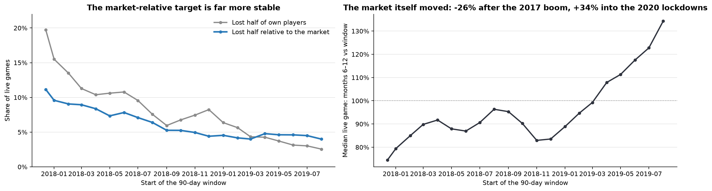
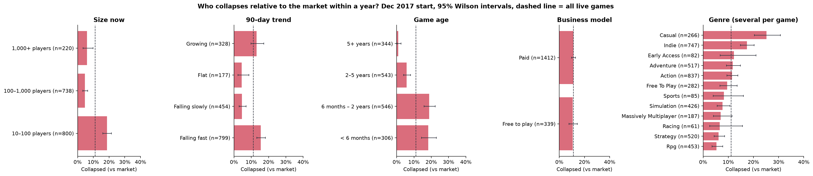
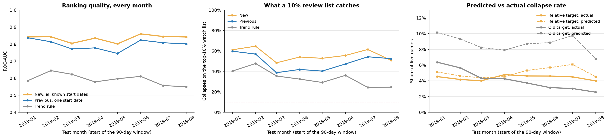
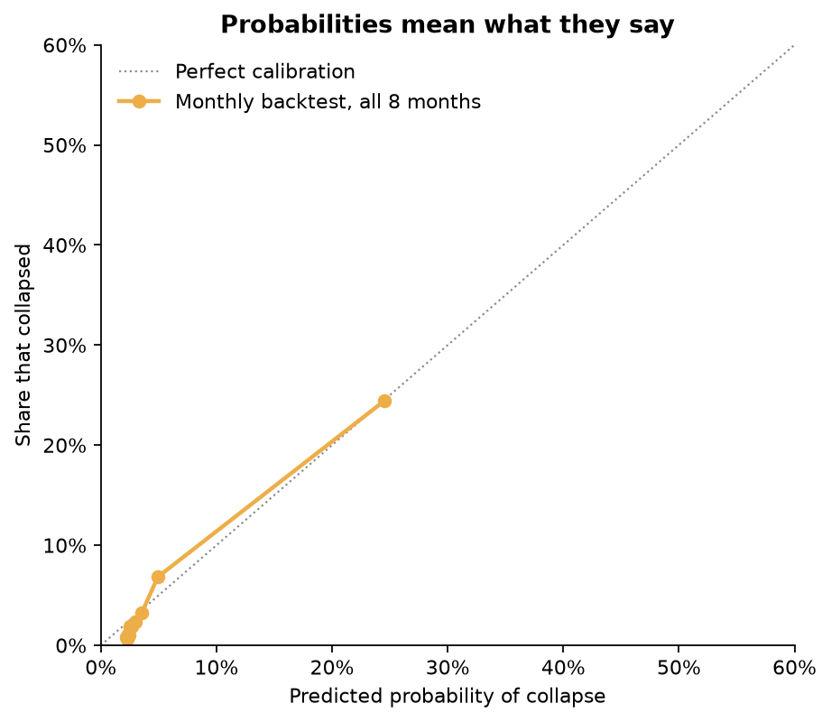
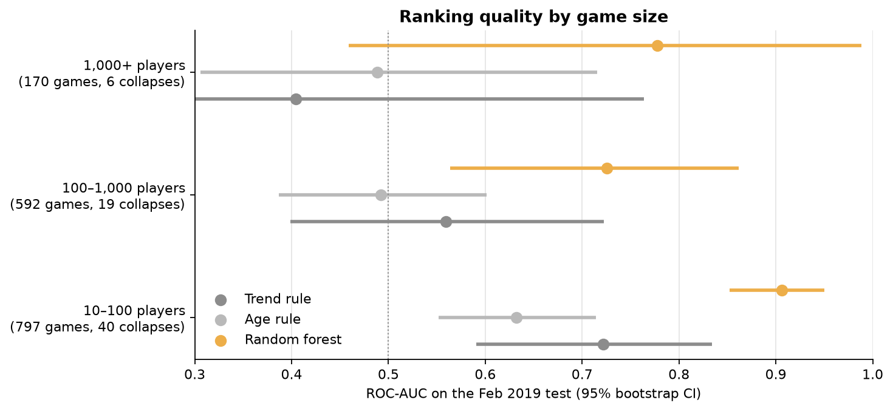
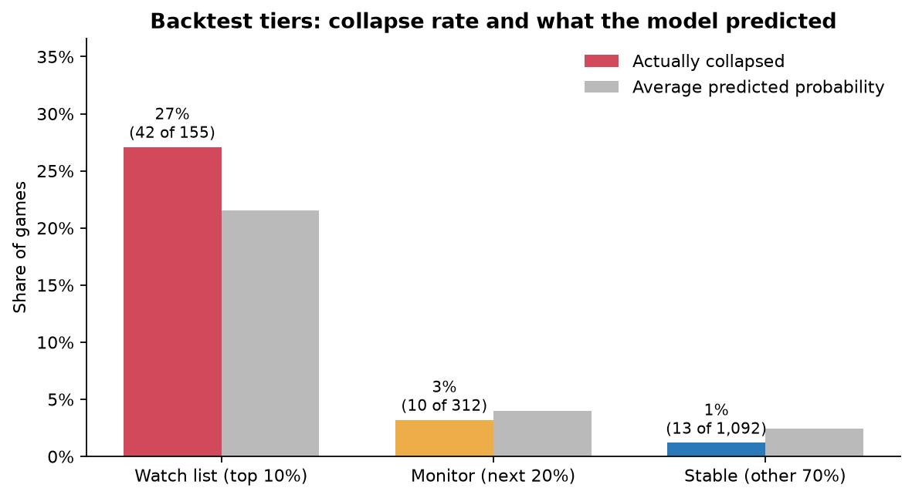

# Steam Decline Watch: predicting which live games will collapse relative to the market

## Summary

Steam Decline Watch scores each live Steam game (≥ 10 average players) for the risk of a **collapse**: over months 6–12, the game's players fall below **half of where the typical live game ends up**. Scores use 90 days of Steam player counts, Twitch attention and store metadata. The data covers 1,851 games tracked every five minutes from 14 Dec 2017 to 12 Aug 2020.

The model is a calibrated random forest. It learns from every monthly start date whose outcome is already known, and every score comes with three plain-language reasons.

- **Ranking:** the monthly backtest (Jan–Aug 2019, retrained each month on outcomes known at the time) averages **ROC-AUC 0.834** (range 0.80–0.86). The 90-day trend rule averages 0.593. On the Feb 2019 test the model scores 0.843 (95% CI 0.778–0.902).
- **Watch list:** the riskiest **10%** of the catalogue held **65%** of all Feb 2019 collapses (95% CI 52–76%), and **56%** on average across the eight months. The trend rule's 10% held 48% and 34%.
- **Probabilities hold across years.** The predicted collapse rate stayed within about 1.5 points of the actual rate every month (4.5–6.1% predicted against 4.0–4.8% actual). The previous target, losing half of a game's *own* players, was up to 3× off, because the market swings.
- **Training on many start dates helps.** It beat training on one start date in all eight months (average AUC 0.834 vs 0.797; watch-list recall 56% vs 49%).
- **Explanations are exact.** Per-game contributions add up to the forest's score to machine precision. Watch-list risk is driven mostly by spiky player counts, one-off peaks, a weak floor and the trend.
- **Limits:** only 6 big games (1,000+ players) collapsed in the Feb 2019 test, too few for a firm claim. Launches are only slightly better than a trend rule (0.769 vs 0.751). Twitch adds nothing.

All numbers come from `reports/decline_metrics.json`, written by `src/decline-analysis.ipynb`. A secondary end-of-life model (stays above 10 players) is summarised in Section 8.

## 1. Problem, users and value

Publishers and live-ops teams fund updates, community management, marketing, servers and sales for many live games at once. Each quarter they must decide **which games are about to lose a large part of their audience**, while there is still time to act or to stop spending.

**What the product does.** Every quarter it scores the whole catalogue:

| Tier | Share of the catalogue | Collapsed in the Feb 2019 backtest | Average predicted | Share of all collapses | Suggested use |
| --- | ---: | ---: | ---: | ---: | --- |
| Watch list | 10% | 27% | 22% | 65% | Review now: plan an update, sale or event, or stop spending |
| Monitor | 20% | 3.2% | 4.0% | 15% | Check monthly |
| Stable | 70% | 1.2% | 2.4% | 20% | No action |

Each game carries a probability, which can be read at face value, and three reasons. For example, *The Division* (4,098 players) got "falling about 50% a month · last month 77% below the first · more volatile than 95% of live games"; it kept 16% of its players. A searchable version of both watch lists is on the project website (`website/index.html`).

**Value.** A team that reviews 10% of its catalogue sees most of next year's collapses. The rules a publisher could apply alone ("it is already falling", "it is new") catch far fewer. Because it uses public Steam data, the same scoring also works for storefronts, subscription services, investors and competitor tracking.

**Research question.** Given 90 days of Steam activity, Twitch attention and metadata, can we predict whether a live game's players over days 180–365 will fall below half of the median live game's relative level?

**Hypotheses.**

- H1: recent Steam activity predicts a collapse.
- H2: Twitch adds value beyond Steam activity.
- H3: collapse rates differ by age, business model and genre.

The analysis is predictive and associative. It makes no causal claims.

## 2. Data

| Source | Content | Size |
| --- | --- | --- |
| Steam player-count histories | Concurrent players every 5 minutes per app | 2,000 apps, 303.6M readings, 14 Dec 2017 – 12 Aug 2020 |
| Steam store metadata | Type, release date, free-to-play, genres, tags, languages, packages, developers, publishers | 2,000 apps |
| SullyGnome | Monthly Twitch statistics for the top 2,000 game categories | Jan 2017 – Dec 2020, 96,000 rows |
| Twitch ↔ Steam map | Candidate links between SullyGnome categories and Steam app IDs (URL slug or exact name) | 1,237 links |

The Kaggle dataset also contains `PriceHistory/` (daily prices for 1,512 games). It starts in Apr 2019, after most of our training windows, and is not used.

## 3. Data life cycle

1. **Collection.** Public Kaggle Steam dataset plus scraped SullyGnome monthly tables (see README).
2. **Cleaning** (`preprocess.ipynb`).
   - 4.77M readings (1.6%) with an unparseable time or count are dropped and counted.
   - Five-minute readings are aggregated to 1.94M game-days. Missing days stay missing and are never set to zero.
   - Release dates are parsed with an explicit format; the 7 month-only dates are recovered.
3. **Validation** (`twitch-mapping.ipynb`).
   - Every Twitch link is scored by name similarity, and links under 0.6 were reviewed by hand.
   - 6 wrong links were removed (e.g. *Monaco* → *Monaco Pinball*, *Insurgency* → the 2007 mod, an umbrella "Jackbox Party Packs" category).
   - 13 games with split Twitch categories were merged.
4. **Selection.** Only `type == "game"` (1,851 apps); live games only (≥ 10 average players in the feature window).
5. **Feature engineering** (`decline-analysis.ipynb`). Features are computed for 21 start dates: 14 Dec 2017, then the 1st of each month from Jan 2018 to Aug 2019.
   - **Steam (8):** log mean players, worst day, share of near-empty days, peak-to-mean, volatility, trend, last-vs-first month, weekend uplift.
   - **Twitch (7):** viewers, peak viewers, watch time, channels, months in the top 2,000, viewers per player, "has a Twitch category" flag.
   - **Metadata (42):** age, Early Access, free-to-play, one 0/1 column per genre, top-20 tags, counts of languages, packages and developers, publisher catalogue size.
6. **Target.** Each game's change is its mean players over days 180–365 (≥ 150 observed days) divided by its mean over days 0–89. The market change is the median of that change across all live games at the same start date. A game **collapses** when its change divided by the market change is below 0.5. The 90 days between the two windows prevent leakage.
7. **Modelling, evaluation and explanation.** Publisher-grouped CV, a Feb 2019 test, a monthly backtest, calibration checks, size and launch slices, ablation, importance, robustness, regression and per-game explanations.
8. **Communication.** Figures in `reports/figures/decline/`, watch lists as CSV and JSON, this report, the pitch brief and the website.

## 4. Method

### 4.1 Why a market-relative target

| Start | Live games | Market change (median game) | Lost half of own players | Collapsed vs market |
| --- | ---: | ---: | ---: | ---: |
| Dec 2017 | 1,758 | −26% | 19.7% | 11.1% |
| Jun 2018 | 1,623 | −13% | 10.8% | 7.8% |
| Feb 2019 | 1,559 | −5% | 5.6% | 4.2% |
| Aug 2019 | 1,528 | +34% (lockdowns) | 2.6% | 4.0% |

The share of games losing half of their own players fell more than sevenfold as the market moved: down after the 2017 boom, up during the 2020 lockdowns. Measured against the market, the share settles at 4–5% from autumn 2018 onwards.

The early drift that remains is partly the panel itself: the same games are tracked for 2.7 years, and older games collapse less. Game age is a feature, and training on many start dates covers every phase.

### 4.2 Training and testing

- **Training pool.** For a test at date T, the model uses every start date whose 12-month outcome was complete before T. For the Feb 2019 test that is Dec 2017, Jan 2018 and Feb 2018: 5,169 rows covering 1,761 games, with a 9.9% collapse rate.
- **Cross-validation** is 5-fold, stratified, and **grouped by publisher**. A game appears once per start date, so the grouping keeps a game and its sibling titles on one side of each split.
- **Monthly backtest.** For each month from Jan to Aug 2019 the model is retrained on its pool (2 to 9 start dates) and scores that month's live games. It is compared with the previous setup (one start date) and the trend rule.
- **Candidates:**
  - *No change*: never flags.
  - *Trend rule*: extends the 90-day trend 7.5 months and flags a projected halving.
  - *Age rule*: flags games under one year old.
  - *Logistic regression*, *random forest* and *gradient boosting*, all with balanced class weights.
- **Model choice.** Grouped CV AUC was 0.928 ± 0.020 for logistic regression, 0.922 ± 0.020 for the random forest and 0.906 ± 0.025 for gradient boosting. The forest, selected by CV in the previous version, stays the fixed model family, since the difference is within one standard deviation. It also allows exact explanations. All three are reported on the test.
- **Calibration.** A sigmoid is fitted on the forest's publisher-grouped out-of-fold scores (`CalibratedClassifierCV`, `ensemble=False`). It is monotonic, so ranking and explanations are unchanged.
- **Metrics:** ROC-AUC; precision, lift and recall of the top-10% watch list; predicted vs actual collapse rate; Brier score; bootstrap 95% intervals (1,000 samples).

## 5. Results

### 5.1 Who collapses (Dec 2017 start, H3)

| Group | Games | Collapsed vs market (95% CI) |
| --- | ---: | --- |
| Under 6 months old | 306 | 18.3% (14.4–23.0) |
| Over 5 years old | 344 | 0.9% (0.3–2.5) |
| 10–100 players | 800 | 18.6% (16.1–21.5) |
| 100–1,000 players | 738 | 4.6% (3.3–6.4) |
| Falling fast | 799 | 15.5% (13.2–18.2) |
| Growing | 328 | 13.1% (9.9–17.2) |
| Flat | 177 | 4.5% (2.3–8.7) |
| Free to play / paid | 339 / 1,412 | 10.6% / 11.2% |
| Casual (genre) | 266 | 25.2% (20.4–30.7) |
| RPG (genre) | 453 | 5.3% (3.6–7.8) |

Growing games collapse almost as often as fast-falling ones: spikes after sales, updates or giveaways fade. Business model makes no difference.

### 5.2 Models vs baselines, Feb 2019 test (H1)

| Feb 2019 (1,559 live games, 65 collapsed) | ROC-AUC (95% CI) | Watch-list recall (95% CI) | Watch-list precision | Lift |
| --- | --- | --- | ---: | ---: |
| No change | 0.500 | 10% | 4.2% | 1.0× |
| Trend rule | 0.645 (0.546–0.737) | 48% (34–58) | 19.9% | 4.8× |
| Age rule | 0.578 (0.521–0.639) | 11% | 4.5% | 1.1× |
| Logistic regression | 0.811 (0.746–0.867) | 55% | 23.1% | 5.5× |
| **Random forest** | **0.843 (0.778–0.902)** | **65% (52–76)** | **26.9%** | **6.5×** |
| Gradient boosting | 0.824 (0.755–0.881) | 63% | 26.3% | 6.3× |

The forest's average predicted probability on this test was 4.6%, against an actual 4.2%.

### 5.3 Monthly backtest and calibration

| Test month (2019) | Training starts | Collapse rate | AUC new | AUC one start | AUC trend | Watch-list recall new | Predicted rate | Old target: predicted / actual |
| --- | ---: | ---: | ---: | ---: | ---: | ---: | ---: | --- |
| Jan | 2 | 4.5% | 0.842 | 0.837 | 0.585 | 61% | 5.1% | 10.1% / 6.4% |
| Feb | 3 | 4.2% | 0.843 | 0.814 | 0.645 | 65% | 4.6% | 9.3% / 5.6% |
| Mar | 4 | 4.0% | 0.804 | 0.772 | 0.623 | 48% | 4.4% | 8.2% / 4.3% |
| Apr | 5 | 4.8% | 0.835 | 0.778 | 0.578 | 54% | 4.5% | 7.9% / 4.3% |
| May | 6 | 4.6% | 0.801 | 0.745 | 0.597 | 53% | 5.3% | 8.7% / 3.7% |
| Jun | 7 | 4.6% | 0.860 | 0.823 | 0.611 | 56% | 5.7% | 8.9% / 3.1% |
| Jul | 8 | 4.5% | 0.845 | 0.808 | 0.557 | 61% | 6.1% | 9.8% / 3.0% |
| Aug | 9 | 4.0% | 0.842 | 0.801 | 0.550 | 51% | 4.5% | 6.8% / 2.6% |
| **Average** | | | **0.834** | **0.797** | **0.593** | **56%** | | |

Pooled over the eight months (12,446 game-months), the riskiest tenth of predictions averaged 24.5% predicted and 24.4% actual. The safest bins are slightly pessimistic, at about 2.3% predicted against 0.6–1.0% actual. The Brier score beat a constant base-rate forecast in every month.

### 5.4 Big games and launches

| Feb 2019 slice | Games | Collapsed | Trend rule AUC | Random forest AUC (95% CI) |
| --- | ---: | ---: | ---: | --- |
| 10–100 players | 797 | 40 | 0.722 | 0.906 (0.852–0.950) |
| 100–1,000 players | 592 | 19 | 0.559 | 0.726 (0.564–0.862) |
| 1,000+ players | 170 | 6 | 0.404 | 0.777 (0.459–0.989) |
| Launch-stage games (own release as origin) | 141 | 50 | 0.751 | 0.769 (0.680–0.859) |

- **Big games.** Six collapses are too few to evaluate. Of the 11 big games on the Feb 2019 watch list, 4 collapsed against the market: GRID 2, The Division, H1Z1 and Borderlands: The Pre-Sequel. ASTRONEER and Subnautica halved, but stayed just above the market line.
- **Launches.** The model's riskiest third collapsed 68% of the time and its safest third 13%, but it is only slightly ahead of the trend rule.

### 5.5 Does Twitch add anything? (H2) What does the model use?

| Feature set (random forest, Feb 2019) | Test AUC (95% CI) | Watch-list recall |
| --- | --- | ---: |
| Metadata only | 0.630 (0.561–0.700) | 25% |
| Twitch only | 0.604 (0.536–0.689) | 26% |
| Metadata + Twitch | 0.652 (0.581–0.724) | 29% |
| Steam only | 0.817 (0.755–0.868) | 58% |
| Metadata + Steam | 0.850 (0.788–0.906) | 66% |
| All | 0.843 (0.772–0.901) | 65% |

- **Adding Twitch** changes AUC by −0.006 (95% CI −0.022 to +0.009).
- **Shuffling each feature group:** Steam activity costs 0.249 AUC, metadata 0.051, genres and tags 0.017.
- **Top single features:** volatility, trend, last-vs-first month and worst day.

### 5.6 Robustness

| Collapse definition (vs market) | Events | Trend rule AUC | Random forest AUC | Watch-list recall |
| --- | ---: | ---: | ---: | ---: |
| Lost ≥ 25% | 239 | 0.511 | 0.808 | 38% |
| Lost ≥ 50% (product) | 65 | 0.645 | 0.843 | 65% |
| Lost ≥ 75% | 20 | 0.764 | 0.956 | 85% |

Regression of the size of the relative change: the forest reaches MAE 0.250 (log units) against 0.269 for "no change", with a rank correlation of 0.38. That is a useful hint, but too weak to sell as an audience forecast.

### 5.7 Explaining each flag

A random forest's probability splits exactly into per-feature contributions. Each tree's prediction is the training mean plus the change at each split on the game's path, and each change belongs to that split's feature. Averaged over 500 trees, the largest mismatch was 7.8 × 10⁻¹⁶.

Contributions are grouped into 14 themes, and the three themes that raise a game's risk most become its reasons, with the game's own numbers. Across watch-list games, risk comes from:

| Theme | Share of the risk-raising contribution |
| --- | ---: |
| Spiky player counts | 22% |
| One-off peaks | 14% |
| Weak floor | 14% |
| Trend | 8% |
| Genre and tags | 8% |
| Last vs first month | 8% |

Many of the riskiest games are small titles whose 90-day average was inflated by a single burst, such as a giveaway or free weekend, followed by near-empty days.

### 5.8 Deliverable

- **Backtest.** `decline_watchlist_backtest_2019.csv` and `.json` hold every Feb 2019 game with its probability, tier, reasons and what actually happened.
- **Forecast.** `decline_watchlist_forecast_2020-08.csv` and `.json` hold the deployable version. It was trained on all 21 start dates and scored on 15 May – 12 Aug 2020: 1,554 live games, average probability 5.1%. The outcome window (Nov 2020 – Aug 2021) lies beyond the data, so it is unverified.
- **Website.** `website/index.html` presents both lists, with search and filters.

## 6. Conclusions

- **H1 supported.** Recent Steam activity predicts a market-relative collapse. Spikiness, trend, the floor and age carry the signal, and ML beats simple rules by a wide margin (monthly AUC 0.834 vs 0.593).
- **H2 not supported.** Twitch adds nothing beyond Steam activity.
- **H3 partly supported.** Young, small, Casual and Indie games collapse more often; business model makes no difference.
- **Product.** A quarterly, calibrated, explained watch list. Reviewing 10% of a catalogue covers 56–65% of collapses, and its probabilities hold across market swings. Big-game and launch performance remain open questions.

## 7. Limitations

- **Big games.** Too few big games collapse against the market (6 in the Feb 2019 test) to estimate performance reliably.
- **Launch stage.** On 141 launches the model is only slightly better than the trend rule. Dedicated launch data is needed.
- **Calibration at the safe end.** The safest games are slightly over-predicted (about 2.3% predicted against 1% actual).
- **Selection and period.** The dataset does not document how its 2,000 apps were chosen and leans towards popular titles. The data covers one platform from 2017 to 2020.
- **Panel aging.** The same games age through the period, which explains part of the early drift in collapse rates.
- **Model choice.** The forest was fixed from the previous version. In this version's CV, logistic regression was marginally higher but within noise, and it scored 0.811 on the test against the forest's 0.843.
- **Associations only.** Reasons show which signals raised a score, not what caused a decline or what will help.
- **Twitch coverage.** Only the top 2,000 categories per month are available, and the script that produced the candidate mapping is not in the repository.

## 8. Secondary model: end of life (stays above 10 players)

`retention-analysis.ipynb` answers a narrower question: will a game keep at least 10 average players in months 6–12? The Feb 2019 test has 1,851 games, 16.6% of which fell below 10.

| Out-of-time test | Rule: ≥ 10 players today | Random forest |
| --- | ---: | ---: |
| ROC-AUC | 0.982 | 0.982 |
| Balanced accuracy | 0.927 | 0.957 |
| Lost games caught | 87% | 94% |
| AUC on 537 borderline games (5–50 players) | 0.931 | 0.961 |

Today's player count already answers this question (flagged games had a median of 2 players), so the model is kept only for end-of-life decisions. Its figures are in `reports/figures/` (top level).

## 9. How the project evolved

1. **First version.** Target "stays above 10 players", with a fake chronological split, an alphabetical "primary genre", an unchecked Twitch mapping and only an "always retained" baseline (AUC 0.958). All of these were fixed.
2. **Second version.** Target "loses half of its own players", trained on one start date. It worked for every size, but its probabilities were up to 3× off between years, because the market swings.
3. **This version.** Market-relative target, every known start date for training, a monthly backtest, calibrated probabilities and per-game reasons.

## 10. Learning outcomes

> Draft: each team member should adjust this section.

- **The target defines the product.** "Stays above 10 players" was accurate but obvious. "Loses half" was useful but unstable. "Loses half relative to the market" is both useful and stable across years.
- **A score means little without a baseline.** Every result is compared with rules a publisher could apply without us.
- **Test the way it will be used.** A monthly backtest, retrained on what was known each month, showed that more history helps and that the market itself swings.
- **Probabilities need their own check.** A model can rank well while its probabilities are wrong. Calibration and predicted-vs-actual rates per period are separate tests.
- **Explanations make a ranking usable**, and the tree decomposition gives exact explanations at no extra data cost.
- **Check every derived column and join.** An alphabetical genre list and fuzzy name matching both silently changed results.
