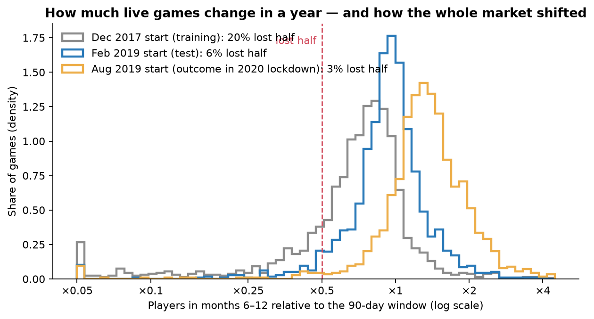
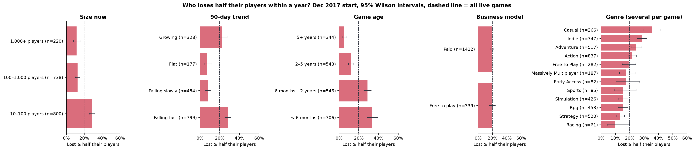
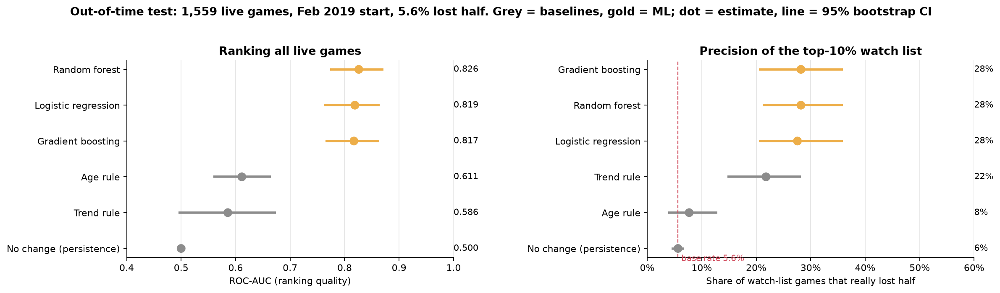
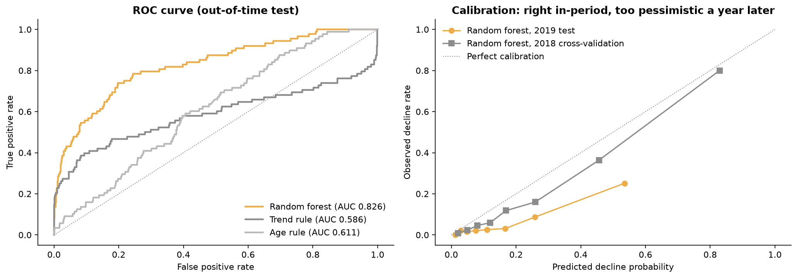
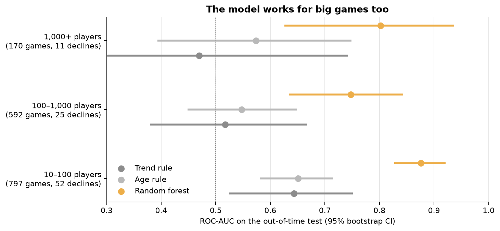
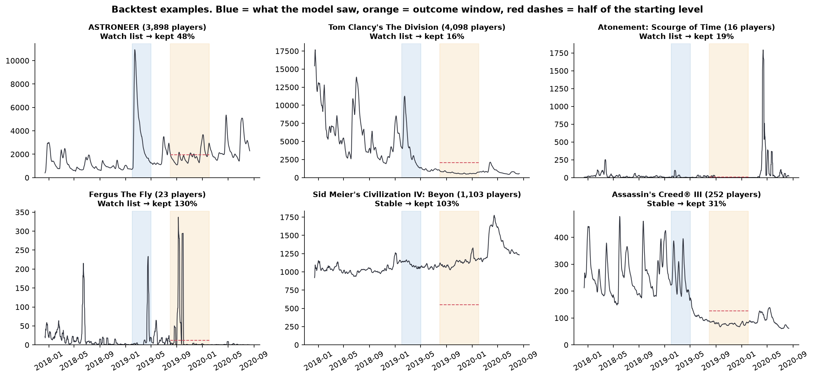
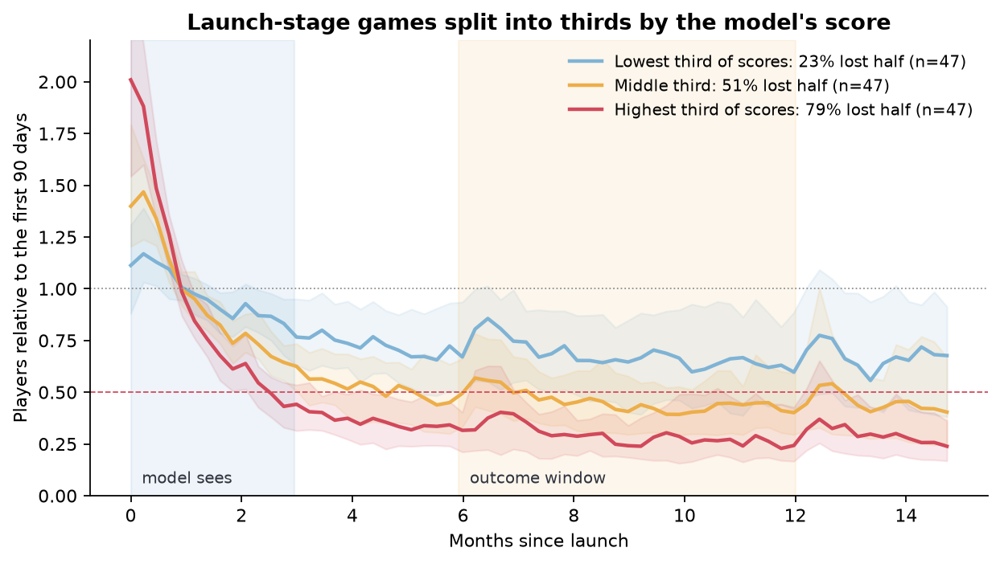
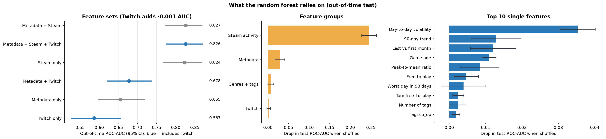
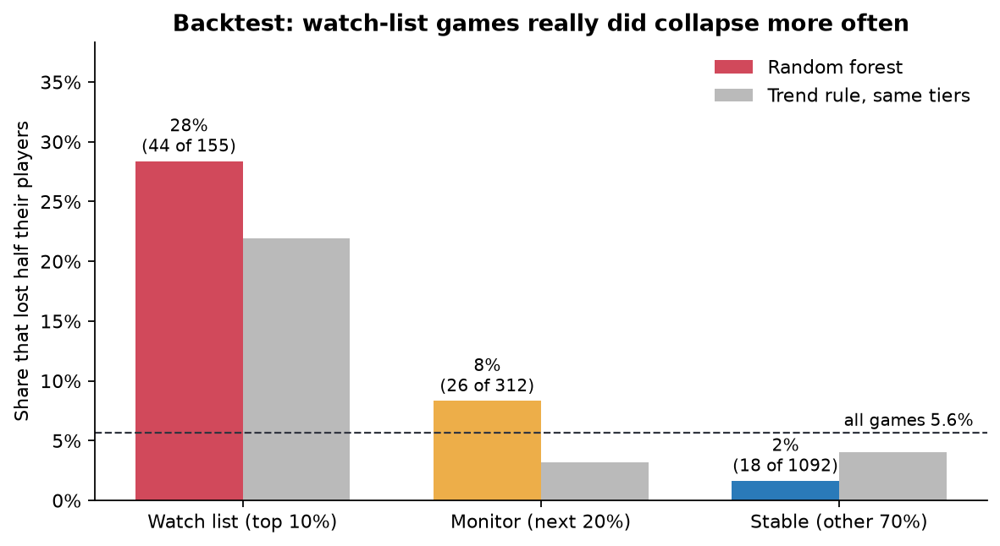

# Which live games will lose half their players? Early decline warning for Steam games

## Summary

We rank live Steam games by their risk of a **major decline**: average concurrent players in months 6–12 falling to **less than half** of today's level. The ranking uses 90 days of Steam player counts, Twitch attention and store metadata. The data covers 1,851 games tracked every five minutes from 14 Dec 2017 to 12 Aug 2020. A game counts as live if it averages at least 10 players.

We trained on Dec 2017 data and tested out-of-time on games starting Feb 2019 (outcome Aug 2019 – Jan 2020; 88 of 1,559 live games, 5.6%, lost half).

- **Ranking:** the random forest reaches **ROC-AUC 0.826** (95% CI 0.774–0.871). Simple rules are near chance: extending the 90-day trend gives 0.586, game age gives 0.611.
- **Watch list:** the riskiest **10%** of the catalogue contained **half of all collapses**. 28% of the games on it lost half, **5× the base rate**.
- **Big games:** AUC 0.80 for games with 1,000+ players, where both rules are at chance. The 2019 watch list included *Tom Clancy's The Division* (4,098 players, kept 16%) and *H1Z1* (2,384 players, kept 30%).
- **Launch-stage games** (141 launches): the model ranks well (AUC 0.787), but no better than the trend rule (0.774). This is the main open problem.
- **Different market periods:** the ranking held in the 2020 lockdown period (AUC 0.826, watch list 5.9× the base rate), even though the share of declining games swung from 20% to 3% between periods.
- **Twitch** adds nothing once Steam activity is known (−0.0006 AUC).

A secondary **end-of-life model** (will a game stay above 10 players?) is reported in Section 7. It is accurate (AUC 0.98), but mostly restates today's player count.

Numbers come from `reports/decline_metrics.json` (`src/decline-analysis.ipynb`) and `reports/metrics.json` (`src/retention-analysis.ipynb`).

## 1. Problem, users and value

Publishers and live-ops teams fund updates, community management, marketing, servers and sales for many live games at once. Their question each quarter is **which games are about to lose a large part of their audience**, while there is still time to act or to stop spending.

For a game with 5,000 players, falling to 800 is a serious business problem. A fixed floor like "10 players" would never flag it.

**What the product does.** Every quarter it ranks the whole catalogue by decline risk:

| Tier | Share of the catalogue | Lost half in the backtest | Share of all collapses | Suggested use |
| --- | ---: | ---: | ---: | --- |
| Watch list | 10% | 28% | 50% | Review now: plan an update, sale or event, or stop spending |
| Monitor | 20% | 8% | 30% | Check monthly |
| Stable | 70% | 1.6% | 20% | No action |

**Value.** A team that reviews only the 10% watch list sees half of next year's collapses, about 5× more often than picking games at random. Watch list plus monitor (30% of the catalogue) covers 80% of collapses. The ranking is built from public data (Steam player counts), so it also works for third parties:

- storefronts and subscription services deciding what to feature or renew;
- investors and acquirers judging a studio's back catalogue;
- competitors tracking a market segment.

**Research question.** Given 90 days of Steam activity, Twitch attention and metadata, can we predict whether a live game's mean players in days 180–365 will fall below half of its mean in the 90-day window?

**Hypotheses.**

- H1: recent Steam activity predicts a later major decline.
- H2: Twitch attention adds predictive value beyond Steam activity.
- H3: decline rates differ by game age, business model and genre.

The analysis is predictive and associative. It makes no causal claims.

## 2. Data

| Source | Content | Size |
| --- | --- | --- |
| Steam player-count histories | Concurrent players every 5 minutes per app | 2,000 apps, 303.6M readings, 14 Dec 2017 – 12 Aug 2020 |
| Steam store metadata | Type, release date, free-to-play, genres, tags, languages, packages, developers, publishers | 2,000 apps |
| SullyGnome | Monthly Twitch statistics for the top 2,000 game categories | Jan 2017 – Dec 2020, 96,000 rows |
| Twitch ↔ Steam map | Candidate links between SullyGnome categories and Steam app IDs (URL slug or exact name) | 1,237 links |

## 3. Data life cycle

1. **Collection.** Public Kaggle Steam dataset plus scraped SullyGnome monthly tables (see README).
2. **Cleaning** (`preprocess.ipynb`).
   - 4.77M readings (1.6%) with an unparseable time or count are dropped and counted.
   - Five-minute readings are aggregated to 1.94M game-days. Missing days stay missing and are never set to zero.
   - Release dates are parsed with an explicit format; the 7 month-only dates are recovered.
3. **Validation** (`twitch-mapping.ipynb`).
   - Every Twitch link is scored by name similarity, and links under 0.6 were reviewed by hand.
   - 6 wrong links were removed (e.g. *Monaco* → *Monaco Pinball*, *Insurgency* → the 2007 mod, an umbrella "Jackbox Party Packs" category).
   - 13 games with split Twitch categories were merged, so no game is double-counted.
4. **Selection.** Only `type == "game"` is kept (1,851 apps); demos, mods, DLC, test servers and adverts are dropped. For the decline model, a game must average ≥ 10 players in the feature window.
5. **Feature engineering** (`decline-analysis.ipynb`, Section 1). Features are computed for an *origin date* t: either one shared date, or each game's own launch for the launch-stage check.
   - **Steam (8):** log mean players, worst day, share of near-empty days, peak-to-mean, volatility, trend, last-vs-first month, weekend uplift.
   - **Twitch (7):** viewers, peak viewers, watch time, channels, months in the top 2,000, viewers per player, "has a Twitch category" flag.
   - **Metadata (42):** age, Early Access, free-to-play, one 0/1 column per genre, top-20 tags, counts of languages, packages and developers, publisher catalogue size.
   - **Target:** mean players over t+180 … t+365 (≥ 150 observed days) divided by the mean over t … t+89. "Major decline" = ratio < 0.5. The 90 days between the windows prevent leakage.
6. **Analysis and modelling.** EDA, five-fold cross-validation grouped by publisher, an out-of-time backtest, size-band and launch-stage evaluation, ablation, permutation importance, robustness checks and regression.
7. **Communication.** Figures in `reports/figures/decline/`, watch lists as CSV, this report and the pitch slides.

## 4. Method

| Role | Origin | Outcome window | Live games | Lost half |
| --- | --- | --- | ---: | ---: |
| Train | 14 Dec 2017 | Jun – Dec 2018 | 1,758 | 19.7% |
| Train (2nd, for the 2020 check) | 14 Jun 2018 | Dec 2018 – Jun 2019 | 1,627 | 10.7% |
| Test | 1 Feb 2019 | Jul 2019 – Jan 2020 | 1,559 | 5.6% |
| Test, lockdown period | 1 Aug 2019 | Jan – Jul 2020 | 1,528 | 2.6% |

Each test uses only training rows whose outcomes were known before the test origin.

**Baselines.**

- *No change* (persistence): predicts no decline for anyone.
- *Trend rule*: extends the 90-day trend 7.5 months ahead and flags games that would lose half, i.e. falling ≥ 9% a month.
- *Age rule*: flags games under one year old.

**Models.** Logistic regression, random forest and histogram gradient boosting, all with balanced class weights. The random forest was **chosen by grouped CV** (AUC 0.889), not on the test set.

**Metrics** (for the decline class): ROC-AUC; precision, lift and recall of the top-10% watch list; balanced accuracy at each method's own cut-off; 1,000-sample bootstrap 95% intervals.

**Why we rank instead of threshold.** The share of games that lost half fell from 19.7% to 2.6% across periods, because the whole market moved:

- after the 2017 boom, many games declined;
- in 2019 the market was calmer;
- in 2020 the lockdowns lifted almost every game.

Probabilities learned in one period are therefore miscalibrated in the next (`fig04`), while the ranking transfers. The product is a ranked watch list.

## 5. Results

### 5.1 Exploration

Decline rates on the Dec 2017 start, with 95% Wilson intervals:

| Group | Games | Lost half |
| --- | ---: | --- |
| 10–100 players | 800 | 28.6% (25.6–31.9) |
| 1,000+ players | 220 | 11.4% (7.8–16.2) |
| Under 6 months old | 306 | 33.7% (28.6–39.1) |
| Over 5 years old | 344 | 4.9% (3.1–7.8) |
| Falling fast | 799 | 28.2% (25.2–31.4) |
| Growing | 328 | 22.6% (18.4–27.4) |
| Flat | 177 | 7.3% (4.3–12.2) |
| Free to play / paid | 339 / 1,412 | 19.5% / 19.6% |
| Casual (genre) | 266 | 35.3% (29.8–41.3) |
| Racing (genre) | 61 | 9.8% (4.6–19.8) |

Two points matter for the model:

- **Growing games decline almost as often as falling ones.** Spikes from sales, updates or giveaways fade, so extending the trend does not work.
- **Free-to-play makes no difference** to relative decline.

### 5.2 Models vs baselines (H1)

| Out-of-time test (1,559 live games, 88 lost half) | ROC-AUC (95% CI) | Watch-list precision (95% CI) | Lift | Share of collapses on the watch list |
| --- | --- | --- | ---: | ---: |
| No change | 0.500 | 5.6% | 1.0× | 10% |
| Trend rule | 0.586 (0.495–0.674) | 21.8% (14.7–28.2) | 3.9× | 39% |
| Age rule | 0.611 (0.559–0.665) | 7.7% | 1.4× | 14% |
| Logistic regression | 0.819 | 27.6% | 4.9× | 49% |
| **Random forest** | **0.826 (0.774–0.871)** | **28.2% (21.2–35.9)** | **5.0×** | **50%** |
| Gradient boosting | 0.817 | 28.2% | 5.0× | 50% |

In grouped CV on the 2018 period, the random forest reached AUC 0.889, against 0.652 for the trend rule and 0.693 for the age rule.

### 5.3 Big games

| Size now | Games | Lost half | Trend rule AUC | Random forest AUC (95% CI) |
| --- | ---: | ---: | ---: | --- |
| 10–100 players | 797 | 52 | 0.643 | 0.876 (0.827–0.921) |
| 100–1,000 players | 592 | 25 | 0.518 | 0.748 (0.634–0.844) |
| 1,000+ players | 170 | 11 | 0.469 | 0.802 (0.626–0.937) |

Five big games made the 2019 watch list, and three of them lost half:

| Game | Players then | Kept |
| --- | ---: | ---: |
| *Tom Clancy's The Division* | 4,098 | 16% |
| *H1Z1* | 2,384 | 30% |
| *ASTRONEER* | 3,898 | 48% |
| *Subnautica* | 4,004 | 56% (not a "decline", but still a large drop) |
| *Minion Masters* | 1,000 | grew |

### 5.4 Launch-stage games

The launch cohort has 141 games with ≥ 10 players:

- 74 released at most 45 days before tracking began;
- 67 Early Access games whose 1.0 release happened during tracking.

Each game's own launch is its origin, so the 90-day window is the launch period. The model is trained on the Dec 2017 catalogue with these games excluded. 51% of launches lost half.

| Launch cohort | ROC-AUC (95% CI) | Precision when flagging | Recall |
| --- | --- | ---: | ---: |
| Trend rule | 0.774 (0.690–0.848) | 61% | 94% |
| Random forest | 0.787 (0.704–0.866) | 79% | 51% |

The model's top third of launches lost half 79% of the time, its bottom third 23%. On ranking it is **on par with the trend rule**: right after launch, the decline is already visible in the first 90 days. A model trained on launches (only 141 here) is the clearest next step.

### 5.5 Does Twitch add anything? (H2) And what does the model use?

| Feature set (random forest) | CV AUC | Test AUC (95% CI) |
| --- | ---: | --- |
| Metadata only | 0.800 | 0.655 (0.597–0.719) |
| Twitch only | 0.664 | 0.587 (0.526–0.657) |
| Metadata + Twitch | 0.808 | 0.678 (0.620–0.737) |
| Steam only | 0.863 | 0.824 (0.766–0.868) |
| Metadata + Steam | 0.892 | 0.827 (0.773–0.870) |
| All | 0.889 | 0.826 (0.774–0.871) |

- **Adding Twitch** to Metadata + Steam changes test AUC by −0.0006 (95% CI −0.009 to +0.008).
- **Shuffling the Steam-activity group** costs 0.246 AUC. Metadata costs 0.029, genres and tags 0.007, Twitch 0.002.
- **Top single features:** volatility, trend, last-vs-first month, game age and peak-to-mean. Spiky, falling and young games are most at risk.

### 5.6 Robustness

| Check | Trend rule AUC | Random forest AUC |
| --- | ---: | ---: |
| Decline = lost ≥ 25% (300 events) | 0.510 | 0.747 |
| Decline = lost ≥ 50% (88 events) | 0.586 | 0.826 |
| Decline = lost ≥ 75% (24 events) | 0.762 | 0.958 |
| 2020 lockdown period (39 events, 2.6%) | 0.562 | 0.826 (0.748–0.896) |

In the lockdown period, the watch list caught 59% of collapses at 5.9× the base rate.

### 5.7 How large will the change be? (regression)

| Test set | MAE (log ratio) | Rank correlation with actual change |
| --- | ---: | ---: |
| No change | 0.274 | – |
| Trend extrapolation | 0.894 | 0.01 |
| Random forest | 0.295 | 0.34 |

Predicting the exact size of the change does not beat "no change". The model's value is in **ranking who is at risk**, not in a precise audience forecast.

### 5.8 Deliverable

| Tier (by rank) | Games | Lost half | Share lost | Share of all collapses | Same tiers from the trend rule |
| --- | ---: | ---: | ---: | ---: | ---: |
| Watch list (top 10%) | 155 | 44 | 28.4% | 50.0% | 21.9% |
| Monitor (next 20%) | 312 | 26 | 8.3% | 29.5% | 3.2% |
| Stable (other 70%) | 1,092 | 18 | 1.6% | 20.5% | 4.0% |

Files:

- `decline_watchlist_backtest_2019.csv`: every test game with its score, tier and actual outcome.
- `decline_watchlist_forecast_2020-08.csv`: the deployable version. It was trained on all four labelled starts and scored on 15 May – 12 Aug 2020 (1,554 live games). Its outcomes fall after the data ends, so it is unverified, and its scoring window is inflated by the lockdown.

## 6. Conclusions

- **H1 supported.** Recent Steam activity predicts a major decline. The signal is in stability, trend and the game's age, not in the player level. ML beats simple rules by a wide margin (AUC 0.83 vs ≤ 0.61).
- **H2 not supported.** Twitch adds nothing beyond Steam activity, and on its own it is weak for this question (AUC 0.59).
- **H3 partly supported.** Young, Casual and Indie games decline more often; business model makes no difference.
- **Product.** A quarterly ranked watch list. It works for games of every size and survives market swings. On launch-stage games it is not yet better than watching the trend.

## 7. Secondary model: end of life (stays above 10 players)

`retention-analysis.ipynb` answers a narrower question: will a game keep at least 10 average players in months 6–12? The test set is 1,851 games, 16.6% of which fell below 10.

| Out-of-time test | Rule: ≥ 10 players today | Random forest |
| --- | ---: | ---: |
| ROC-AUC | 0.982 | 0.982 |
| Balanced accuracy | 0.927 | 0.957 |
| Lost games caught | 87% | 94% |
| AUC on 537 borderline games (5–50 players) | 0.931 | 0.961 |
| Balanced accuracy, 2018 period (CV) | 0.691 | 0.957 |

Today's player count already answers this question. The games flagged "high risk" had a median of 2 players, and big games can never be flagged. The model only adds value for borderline games and in stability across periods. We keep it for end-of-life decisions, such as closing servers or ending support, and use the decline watch list as the main product. Figures for this model are in `reports/figures/` (top level).

## 8. Limitations

- **Launch stage.** On 141 launches the model is only on par with the trend rule. Dedicated launch data is needed.
- **Selection.** The dataset does not document how its 2,000 apps were chosen. Its list starts with the most-played games, so it may lean towards popular titles.
- **One market history.** Tests cover two later periods (2019, 2020) from one platform and one data source. Base rates shift strongly between periods, so the probabilities must be recalibrated, or only the ranking used.
- **Small big-game sample.** Only 11 of the 170 big games declined in the test, so their AUC interval is wide (0.63–0.94).
- **Threshold choice.** "Half" is a business choice, though results hold for 25%, 50% and 75% losses. "Live" (≥ 10 players) is also a choice.
- **Twitch coverage.** Only the top 2,000 categories a month are available. The script that produced the candidate mapping is not in the repository.
- **Associations only.** A watch-list flag says where to look, not what will help.
- **Dependencies between games.** Publisher grouping in CV limits leakage between sibling titles, but the test set reuses the same games at a later time, as in real monitoring.

## 9. What we changed after review

The first version reported ROC-AUC 0.958 against an "always retained" baseline. A review found five problems:

1. **Mislabelled "early" features.** They were the first 90 days of *data collection*, not of a game's life.
2. **A non-chronological split.** The "chronological split" cut at the collection start date, so the test set was the 117 games first recorded 4 days later.
3. **An alphabetical "primary genre".** It was simply the first genre alphabetically.
4. **Unchecked Twitch mapping.** It contained wrong and duplicated links.
5. **Selection on the test set**, with no intervals and no realistic baseline.

All five are fixed. A second review asked what problem the 10-player target really solves: its "high risk" games already had about 2 players. This led to the relative-decline product, which works for games of every size and beats simple rules by a wide margin.

## 10. Learning outcomes

*(Draft: each team member should adjust this section.)*

- **The target defines the product.** An accurate model of an obvious question ("will a 2-player game stay small?") has little value. Reframing the target to relative decline made the model useful.
- A strong model score means little without a strong baseline. "Players today" explains most of "players next year", but not *how* a game will change.
- The validation design must match the deployment question. A split by first observation date is not a time split, and an out-of-time backtest is. Market-wide shifts mean rankings transfer and probabilities do not.
- Check the meaning of every derived column. An alphabetical genre list silently produced a fake "primary genre".
- Joined data needs its own validation: fuzzy and URL matching produced wrong and duplicated links.
- Report uncertainty, pick the model without looking at the test set, and say where the model does *not* help (launch stage, audience size).
