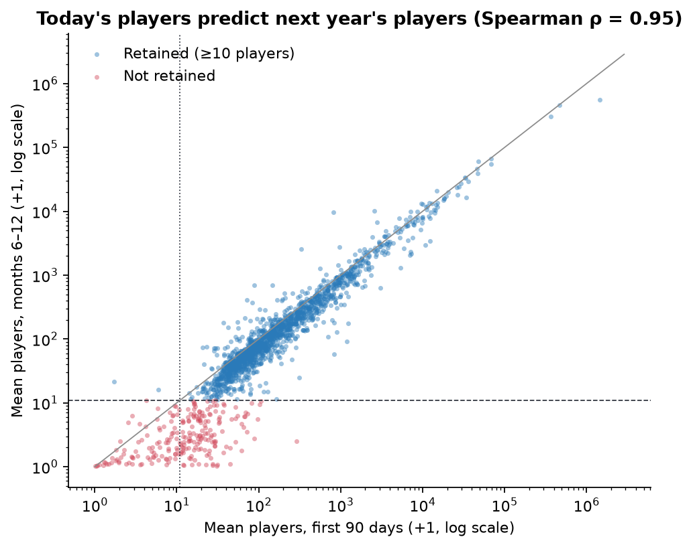
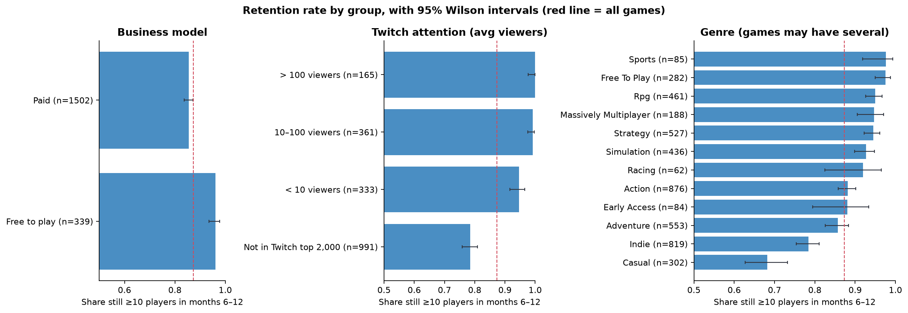
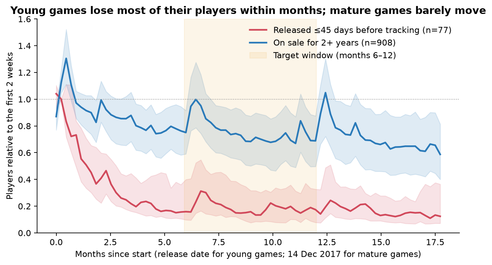
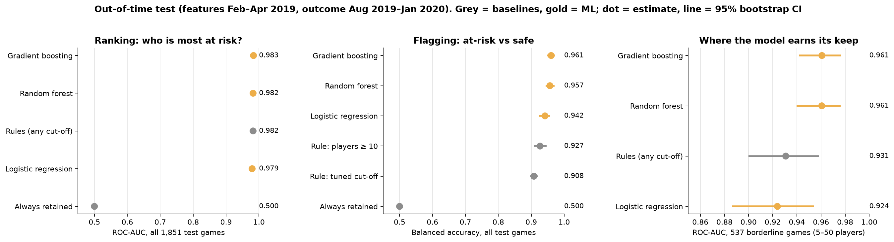
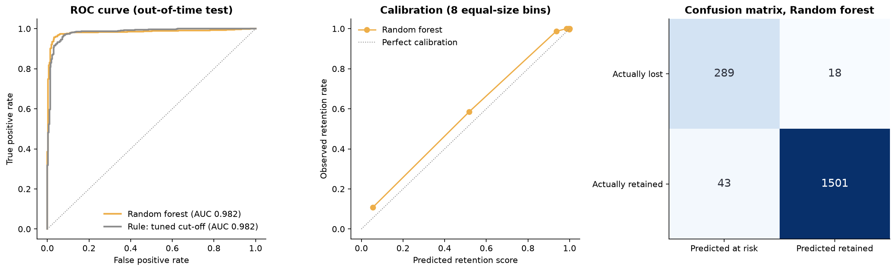
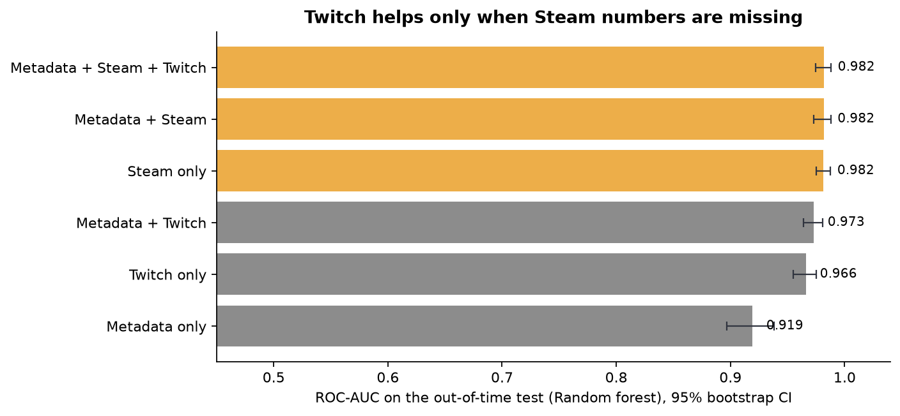
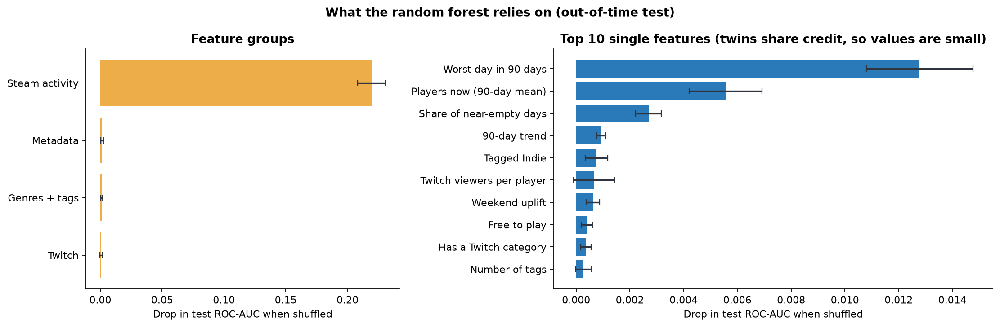
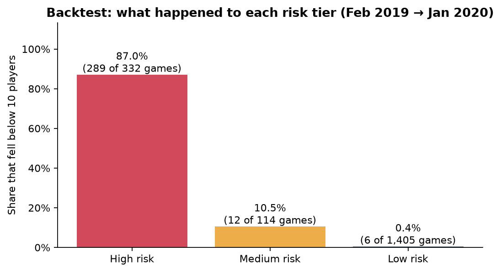
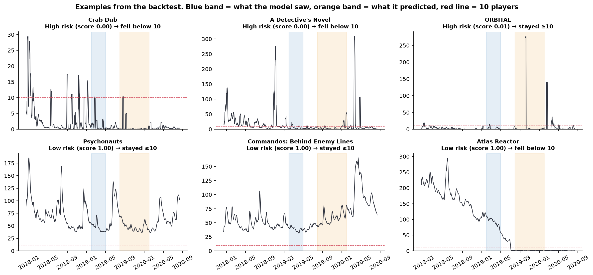

# Will this game still have players next year? Predicting Steam player retention

## Summary

We predict whether a Steam game will still average **at least 10 concurrent players 6–12 months from now**, using 90 days of Steam player counts, Twitch attention and store metadata. The data covers 1,851 games tracked every five minutes from 14 Dec 2017 to 12 Aug 2020.

We trained on Dec 2017 data and tested out-of-time on Feb 2019 → Jan 2020 outcomes. In that test, a random forest reaches ROC-AUC 0.982 and balanced accuracy 0.957, and catches 94% of the games that were lost. An honest baseline does almost as well on ranking: the rule "at risk if fewer than 10 players today" also reaches ROC-AUC 0.982, with balanced accuracy 0.927 and 87% recall. The model's added value is concentrated in three places:

1. **Flagging:** more lost games caught (94% vs 87%) at a precision of 87%.
2. **Borderline games** (5–50 players): ROC-AUC 0.961 vs 0.931; lost games caught 84% vs 58%.
3. **Stability across market periods:** the model keeps a balanced accuracy of 0.95–0.96, while the fixed rule ranges from 0.69 (2018) to 0.93 (2019).

Twitch viewership predicts retention on its own (AUC 0.966), but adds nothing once Steam data is known (+0.0002 AUC, 95% CI −0.0012 to +0.0023). The deliverable is a risk-tier table. In the backtest, 87% of "high risk" games were lost, against 0.4% of "low risk" games.

All numbers below come from `reports/metrics.json`, which `src/retention-analysis.ipynb` writes.

## 1. Problem and target users

Publishers, portfolio managers and live-ops teams fund updates, community management, marketing and servers for many live games at once. Most games fade gradually, and a decision to reinvest or wind down is easier to make before the fade is obvious. We provide an early, quantified risk flag per game.

**Research question.** Given 90 days of Steam activity, Twitch attention and metadata, can we predict whether a game's mean concurrent players in days 180–365 after that window starts will be ≥ 10?

**Hypotheses.**

- H1: recent Steam activity predicts later retention.
- H2: Twitch attention adds predictive value beyond Steam activity.
- H3: retention differs by business model and genre.

The analysis is predictive and associative. It makes no causal claims.

## 2. Data

| Source | Content | Size |
| --- | --- | --- |
| Steam player-count histories | Concurrent players every 5 minutes per app | 2,000 apps, 303.6M readings, 14 Dec 2017 – 12 Aug 2020 |
| Steam store metadata | Type, release date, free-to-play, genres, tags, languages, packages, developers, publishers | 2,000 apps |
| SullyGnome | Monthly Twitch statistics for the top 2,000 game categories | Jan 2017 – Dec 2020, 96,000 rows |
| Twitch ↔ Steam map | Candidate links between SullyGnome categories and Steam app IDs (URL slug or exact name) | 1,237 links |

## 3. Data life cycle

1. **Collection.** Public Kaggle Steam dataset plus scraped SullyGnome monthly tables (see README).
2. **Cleaning** (`preprocess.ipynb`).
   - 4.77M readings (1.6%) with an unparseable time or count are dropped and counted.
   - Five-minute readings are aggregated to 1.94M game-days. Missing days stay missing and are never set to zero.
   - Release dates are parsed with an explicit format; the 7 month-only dates are recovered.
3. **Validation** (`twitch-mapping.ipynb`).
   - Every Twitch link is scored by name similarity, and links under 0.6 were reviewed by hand.
   - 6 wrong links were removed (e.g. *Monaco* → *Monaco Pinball*, *Insurgency* → the 2007 mod, an umbrella "Jackbox Party Packs" category).
   - 13 games with split Twitch categories were merged, so no game is double-counted.
4. **Selection.** Only `type == "game"` is kept (1,851 apps). Demos, mods, DLC, test servers and adverts are dropped.
5. **Feature engineering** (`retention-analysis.ipynb`, Section 2). Features are computed for any *origin date* t:
   - **Steam (8):** log mean players, worst day, share of near-empty days, peak-to-mean, volatility, trend, last-vs-first month, weekend uplift.
   - **Twitch (7):** viewers, peak viewers, watch time, channels, months in the top 2,000, viewers per player, "has a Twitch category" flag.
   - **Metadata (42):** age, Early Access, free-to-play, one 0/1 column per genre, top-20 tags, counts of languages, packages and developers, publisher catalogue size.
   - **Target:** mean players over t+180 … t+365, with at least 150 observed days. The 90 days between the feature and target windows prevent leakage.
6. **Analysis and modelling.** EDA, five-fold cross-validation grouped by publisher, an out-of-time backtest, ablation, permutation importance, threshold and period robustness, and regression.
7. **Communication.** Figures in `reports/figures/`, risk tables as CSV, this report and the pitch slides.

## 4. Method

**Origins.**

| Role | Origin | Target window | Games | Retained |
| --- | --- | --- | ---: | ---: |
| Train | 14 Dec 2017 | Jun – Dec 2018 | 1,850 | 87.4% |
| Train (2nd, for the 2020 check) | 14 Jun 2018 | Dec 2018 – Jun 2019 | 1,850 | 85.2% |
| Test | 1 Feb 2019 | Jul 2019 – Jan 2020 | 1,851 | 83.4% |
| Test, lockdown period | 1 Aug 2019 | Jan – Jul 2020 | 1,851 | 86.2% |

Each test uses only training rows whose outcomes were known before the test origin.

**Candidates.**

- Always retained.
- Rule "≥ 10 players today".
- The same rule with its cut-off tuned on training data.
- Logistic regression, random forest and histogram gradient boosting, all with balanced class weights.

The final model (random forest) was **chosen by grouped CV** (AUC 0.991), not on the test set.

**Metrics.** About 13–17% of games are lost, so we report ROC-AUC, balanced accuracy, precision and recall of the at-risk class, and 1,000-sample bootstrap 95% intervals on the test set.

## 5. Results

### 5.1 Exploration

Players today and players a year later are almost the same ranking (Spearman ρ ≈ 0.95), so persistence is the natural baseline.

| Group | Games | Retained (95% CI) |
| --- | ---: | --- |
| Free to play | 339 | 96.2% (93.6–97.7) |
| Paid | 1,502 | 85.5% (83.6–87.2) |
| Casual (genre) | 302 | 68.2% (62.8–73.2) |
| Indie (genre) | 819 | 78.4% (75.4–81.1) |
| RPG (genre) | 461 | 95.0% (92.6–96.7) |
| Twitch > 100 avg viewers | 165 | 100% (97.7–100) |
| Not in Twitch top 2,000 | 991 | 78.5% (75.8–81.0) |

Games released at most 45 days before tracking began lost a median of about 80% of their players within five months. Games on sale for 2+ years drift slowly, with spikes at the summer and winter sales.

### 5.2 Models vs baselines

| Out-of-time test (1,851 games, 16.6% lost) | ROC-AUC (95% CI) | Balanced acc. | At-risk precision | At-risk recall |
| --- | --- | ---: | ---: | ---: |
| Always retained | 0.500 | 0.500 | – | 0.0% |
| Rule: ≥ 10 players | 0.982 (0.973–0.989) | 0.927 | 91.4% | 87.0% |
| Rule: tuned cut-off (32 players) | 0.982 (0.973–0.989) | 0.908 | 54.2% | 98.1% |
| Logistic regression | 0.979 | 0.942 | 81.6% | 92.5% |
| **Random forest** | **0.982 (0.975–0.988)** | **0.957** | **87.1%** | **94.1%** |
| Gradient boosting | 0.983 | 0.961 | 84.0% | 95.8% |

Borderline games (537 games with 5–50 players, 85 of them lost):

| Model | ROC-AUC (95% CI) | Balanced acc. | Lost games caught |
| --- | --- | ---: | ---: |
| Rule: ≥ 10 players | 0.931 (0.900–0.959) | 0.783 | 57.6% |
| Random forest | 0.961 (0.940–0.976) | 0.894 | 83.5% |

In grouped CV on the 2018 period, the "≥ 10 players" rule reached a balanced accuracy of only **0.691**, against 0.957 for the random forest. Many games that faded during 2018 still had 10+ players in early 2018. Its 0.927 on the 2019 test therefore reflects a calmer period, not a reliable rule. A cut-off tuned on 2018 data (32 players) transfers badly to 2019 (0.908).

### 5.3 Does Twitch add anything? (H2)

| Feature set (random forest) | CV AUC | Test AUC (95% CI) |
| --- | ---: | --- |
| Metadata only | 0.948 | 0.919 (0.897–0.938) |
| Twitch only | 0.946 | 0.966 (0.955–0.975) |
| Metadata + Twitch | 0.980 | 0.973 (0.964–0.981) |
| Steam only | 0.988 | 0.982 (0.975–0.988) |
| Metadata + Steam | 0.990 | 0.982 (0.973–0.988) |
| All | 0.991 | 0.982 (0.975–0.988) |

A paired bootstrap of adding Twitch to Metadata + Steam gives +0.0002 AUC (95% CI −0.0012 to +0.0023).

### 5.4 What the model relies on

The importance test shuffles a whole group of features at once and measures the drop in test AUC:

- Steam activity: 0.219.
- Every other group: < 0.002.

Among single features, the **worst day** in the window matters most, ahead of the 90-day mean and the share of near-empty days.

### 5.5 Robustness

- **Threshold** (`fig07`): for cut-offs of 1, 5, 10, 25, 50 and 100 players, AUC stays at 0.97–0.99 and the model's balanced accuracy at 0.93–0.96.
- **2020 lockdown period** (Aug 2019 origin, 13.8% lost):
  - Random forest: AUC 0.969, balanced accuracy 0.948.
  - Rule: AUC 0.967, balanced accuracy 0.935.
  - At-risk precision fell to 64%, because some games the model expected to fade were rescued by the lockdown surge.
- **Young games** (77 games, 12 lost; out-of-fold CV scores): random forest AUC 0.889 vs rule 0.896. The model does **not** beat the rule on launch-stage games.

### 5.6 Regression: how many players?

| Test set | MAE (log) | Median abs. % error | Within ±25% |
| --- | ---: | ---: | ---: |
| Persistence (next year = today) | 0.314 | 20.8% | 56.0% |
| Linear regression | 0.337 | 22.7% | 53.8% |
| Random forest | 0.321 | 21.7% | 55.7% |

Machine learning does not beat persistence for audience size. The old R² of 0.95 was computed on raw counts, where a few very large games dominate the score.

### 5.7 Deliverable: risk tiers

| Tier (score) | Games | Lost | Share lost | Share of all lost games |
| --- | ---: | ---: | ---: | ---: |
| High risk (< 0.5) | 332 | 289 | 87.0% | 94.1% |
| Medium risk (0.5–0.8) | 114 | 12 | 10.5% | 3.9% |
| Low risk (≥ 0.8) | 1,405 | 6 | 0.4% | 2.0% |

`risk_table_backtest_2019.csv` lists every test game with its score, tier and actual outcome. `risk_forecast_2020-08.csv` holds the deployable version: it was trained on all four labelled origins and scored on 15 May – 12 Aug 2020, giving 349 high-, 62 medium- and 1,440 low-risk games. Its outcomes fall after the data ends, so it is unverified.

## 6. Conclusions

- **H1 supported.** Recent Steam activity carries nearly all the signal, with the player floor first.
- **H2 not supported.** Twitch is a good proxy when Steam data is missing, and redundant when it is present.
- **H3 supported descriptively.** Free-to-play, RPG and Strategy games retain more often, and Casual and Indie games less, but these features add < 0.005 AUC once player counts are known.

**Practical use.** A publisher can triage a catalogue automatically. High- and low-risk tiers are reliable enough to act on, and the 6% of games in the medium tier form a short list for human review. Beyond the original use case, the same setup could serve:

- platform holders or storefronts (which titles to feature or support);
- investors in game studios (back-catalogue health);
- server and hosting planning for multiplayer games.

## 7. Limitations

- **Not a launch-day predictor.** The data starts when most games were already on sale, and on the 77 young games the model does not beat the simple rule.
- **Selection.** The dataset does not document how its 2,000 apps were chosen. Its list starts with the most-played games, so it may lean towards popular titles.
- **One market history.** We test on two later periods (2019, 2020), but both come from one data source and one platform.
- **Threshold.** 10 players is an operational choice, not derived from revenue; the results hold from 1 to 100 players.
- **Twitch coverage.** Only the top 2,000 categories per month are available, so smaller games show zero. The original script that produced the candidate mapping is not in the repository.
- **Associations only.** A high-risk score says where to look, not what will help.
- **Dependencies between games.** Publisher grouping in CV limits leakage between sibling titles, but the test set reuses the same games at a later time, by design of the monitoring use case.

## 8. What we changed after review

The first version reported ROC-AUC 0.958 against an "always retained" baseline. A review found five problems:

1. **Mislabelled "early" features.** They were the first 90 days of *data collection*, not of a game's life.
2. **A non-chronological split.** The "chronological split" cut at the collection start date, so the test set was the 117 games first recorded 4 days later.
3. **An alphabetical "primary genre".** It was simply the first genre alphabetically.
4. **Unchecked Twitch mapping.** It contained wrong and duplicated links.
5. **Selection on the test set**, with no intervals and no realistic baseline.

All five are fixed as described above. The headline numbers are now lower in places but defensible.

## 9. Learning outcomes

*(Draft: each team member should adjust this section.)*

- A strong model score means little without a strong baseline. Here, "players today" explains most of "players next year".
- The validation design must match the deployment question. A split by first observation date is not a time split, and an out-of-time backtest is.
- Check the meaning of every derived column. An alphabetical genre list silently produced a fake "primary genre".
- Joined data needs its own validation: fuzzy and URL matching produced wrong and duplicated links.
- Report uncertainty, and pick the model without looking at the test set.
- Communicate where a model adds value (borderline cases, stability) and where it does not (launch-stage games, audience size).
